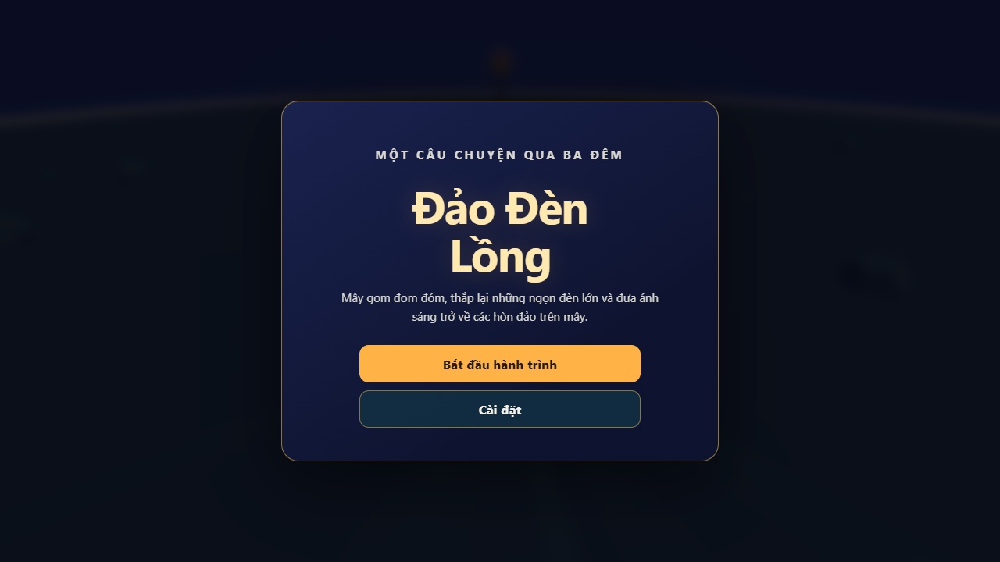

# Đảo Đèn Lồng

> **Video demo:** [Đảo Đèn Lồng (MP4)](docs/demo/202611200804.mp4) · Lab Day 12 AI SDLC · Bùi Xuân Thành · 2A202603521
> Tài liệu gốc của lab: [docs/lab/LAB_README.md](docs/lab/LAB_README.md), [GUIDE](GUIDE.md), [RUBRIC](RUBRIC.md), [SUBMISSION](SUBMISSION.md)

Game 3D góc nhìn thứ ba. Mây, người giữ đèn nhỏ tuổi đội nón lá, đi qua ba hòn đảo trên mây, gom đom đóm, thắp lại những chiếc đèn lồng trước bình minh và né Bóng Mực cùng Gió Lạc.



## Cài đặt và chạy

Yêu cầu Node.js ≥ 18. Không cần cài dependency.

Chạy game từ repo đã clone bằng một lệnh:

```bash
npm start
```

Kiểm chứng và đồng bộ contract:

```bash
npm test
npm run proof
npm run contract
```

Benchmark đồ họa mở Chromium headless và đo cảnh 1280×720 thật; soak chạy 10 đêm trong một tiến trình:

```bash
node scripts/bench.mjs --seed 42 --duration 30 --out docs/proof/phase-4/bench.json
node --no-opt --max-semi-space-size=1 --expose-gc src/headless/soak.js --seed 7 --nights 10 --out docs/proof/phase-4/soak.json
```

Benchmark cần Chrome/Chromium cài trên máy (có thể đặt `CHROME_PATH`). Nó yêu cầu WebGL và tắt vsync bằng cờ trình duyệt; `peak_mem_mb` trả `null` vì Chrome không cung cấp RSS tiến trình cho trang web. Số benchmark tại máy phát triển chỉ tham khảo, ngưỡng được chấm trên máy giảng viên.

Để sinh bằng chứng Phase 2: PowerShell dùng `$env:PHASE='phase-2'; npm run proof`; macOS/Linux dùng `PHASE=phase-2 npm run proof`.

## Điều khiển

| Phím | Việc |
|---|---|
| W A S D / ↑ ↓ | Di chuyển theo hướng camera |
| Kéo chuột / ← → | Xoay camera |
| Space | Nhảy |
| Shift | Lướt |
| E | Nạp đom đóm vào đèn ở gần |
| Q | Tỏa sáng: tốn 3 đom đóm, làm choáng Bóng Mực và tác động tới Gió Lạc |
| Esc / P | Tạm dừng |

## Hành trình ba đêm

- **Đêm 1 — Đảo Bến:** năm đèn, đảo tròn bán kính 40 m.
- **Đêm 2 — Đảo Cau:** hai đảo nối bằng cầu tre và hai bục phóng; Gió Lạc xuất hiện.
- **Đêm 3 — Đảo Chuông:** ba tầng, dốc, bục phóng và những cơn gió; Gió Lạc tiếp tục xuất hiện.

Mỗi đèn cần 10 đom đóm; Mây mang tối đa 10. Bóng Mực chạm làm mất một Ngọn Lửa và khiến Mây rơi một nửa số đom đóm đang mang. Hết lửa thì thua ngay; nếu trời sáng trước khi thắp hết đèn thì thua. Thắng một đêm sẽ cộng điểm và mở đêm kế tiếp. Thắng đêm thứ ba hiện tổng điểm của các đêm đã thắng.

Toàn bộ tuning và hình học bản đồ được khai báo trong [`src/core/config.js`](src/core/config.js), sinh ra [`game.contract.json`](game.contract.json). Giả định Phase 2 nằm trong [`docs/notes/phase-2-assumptions.md`](docs/notes/phase-2-assumptions.md).

## Test Contract v1.3 và headless

```bash
npm test
node src/headless/cli.js --seed 1 --night 1 --ticks 600 --out out.jsonl \
     [--scenario scenario.json] [--inputs inputs.json] [--snapshot-every 10]
```

Contract ở repo hiện là v1.3; headless giữ tham số và hành vi tương thích các bản trước. Để xuất bảng xếp hạng sau khi đã chạy game bằng `npm start`:

```bash
npm start -- --export-leaderboard out.json
```

Điểm được lưu cục bộ trong `.local/leaderboard.json` (bị loại khỏi Git). Cài đặt phím, chuyển động và cỡ chữ lưu trên trình duyệt của thiết bị.

Cài đặt còn có chế độ bảng màu dễ phân biệt, giảm chuyển động và chữ lớn; đèn tắt được làm nhỏ và có dấu rách để không chỉ phân biệt bằng màu.

CLI nhận `--night 1`, `--night 2` hoặc `--night 3`. Một đêm đầy đủ có tối đa 21.600 tick. Snapshot giữ mốc tick 0, event ghi tick k+1 và output kết thúc bằng dòng `end`. Mã thoát 2 báo file scenario/input sai định dạng.

## Cấu trúc và harness

```text
src/core/        luật chơi thuần, tất định
src/headless/    CLI theo Test Contract v1.1 và kiểm tra định dạng
web/             Three.js: hiển thị, âm thanh, menu và đọc phím
tests/           unit test, test CLI, tests/scenarios/*.json
scripts/         serve, proof, gen-contract, check
docs/notes/      giả định, nhật ký AI, đánh giá
docs/proof/      bằng chứng từng phase
AGENTS.md, .claude/  hướng dẫn agent, verify-game và reviewer
```

- [`AGENTS.md`](AGENTS.md): kiến trúc, lệnh và quy tắc phát triển.
- [Skill `verify-game`](.claude/skills/verify-game/SKILL.md): test, scenario, proof và kiểm tra giao diện.
- [Subagent `reviewer`](.claude/agents/reviewer.md): review chỉ đọc trước khi gắn tag phase.
- CI chạy `npm test` và `npm run proof` trên Ubuntu/macOS khi push.

## Sáng tạo từ Phase 1

Mây có các đom đóm bay vòng quanh; đảo sáng dần theo tiến độ và đèn sáng tạo vòng vùng an toàn. Các phần này chỉ thay đổi hiển thị và vẫn giữ output headless Phase 1. Bằng chứng Phase 1: [docs/proof/phase-1/](docs/proof/phase-1/).

## Ghi chép

- [Bằng chứng Phase 2](docs/proof/phase-2/README.md)
- [Yêu cầu, tiêu chí nghiệm thu và giả định Phase 4](docs/notes/phase-4-assumptions.md)
- [Phase 4 retro](docs/notes/retro.md)
- [Nhật ký dùng AI](docs/notes/ai-log.md)
- [Đánh giá từng phase](docs/notes/evaluation.md)
